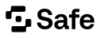

  <a href="https://safe.global">
    <picture>
      <source media="(prefers-color-scheme: dark)" srcset="assets/safe-logo-white.svg">
      
    </picture>
  </a>

# Safe Dev Space

This organization is where new ideas around Safe are tested: experiments, prototypes, and research code.

> [!NOTE]
> Unless a repository says otherwise, the code here is unaudited, provided as is, and not meant for production use or for securing real funds.

[Website](https://safe.global) · [Documentation](https://docs.safe.global)

## About This Repository

This repository holds the files that apply to every repository in the organization unless a repository has its own copy.

| File | Purpose |
| --- | --- |
| [`SECURITY.md`](SECURITY.md) | Default security policy: how to report a vulnerability and what to expect. |

## Reporting a Security Issue

Please do not open a public issue. Follow the [security policy](SECURITY.md), or write to `security@safe.global`.

## Related Organizations

- [safe-global](https://github.com/safe-global): production code maintained by Safe Labs.
- [safe-fndn](https://github.com/safe-fndn): the Safe Smart Account contracts and modules, maintained by the Safe Ecosystem Foundation.
